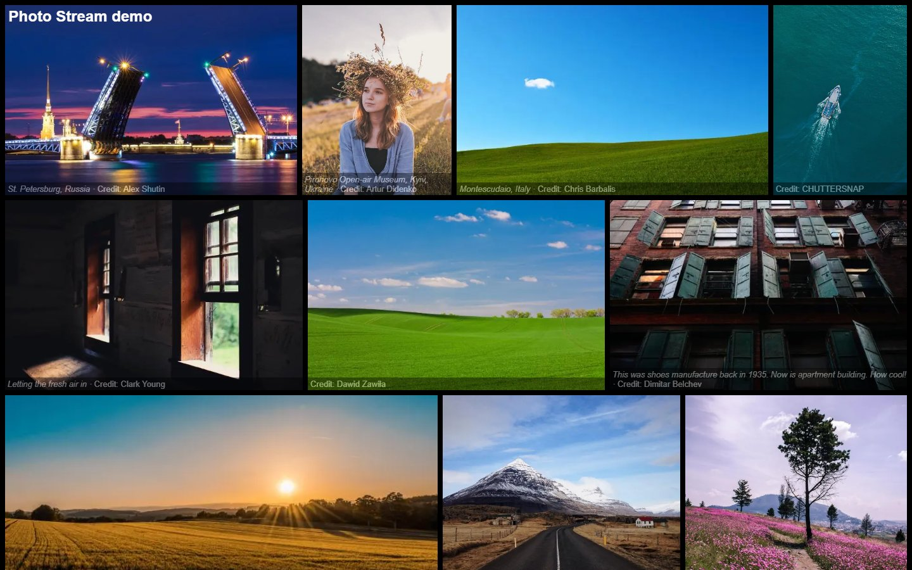

# Photo Stream

_Photo Stream_ is a self hosted static website for your photos, with really good loading performance, powered by [Cecil](https://cecil.app).



Demo: <https://photo-stream-demo.cecil.app> (hosted by [Netlify](https://www.netlify.com) and fed by [Unsplash](https://unsplash.com)).

## Features

- Responsive images & mobile friendly
- Files optimized and lazy loaded
- Rich content caption
- Photo metadata (EXIF) in the lightbox
- Image placeholder (low quality or dominant color)
- Keyboard navigation
- Direct download button (original or resized file)
- Shareable link to each photo
- Atom feed of the latest photos
- Simple workflow: drag & drop and commit

## Install

> PHP 8.3+ and [Cecil](https://cecil.app/download/) 9 are required.

First you should clone or download the [Git repository](https://github.com/Cecilapp/photo-stream.git), or run `composer create-project cecil/photo-stream myproject`.

Then download `cecil.phar` with the following command (this is done automatically by `composer create-project`):

```bash
curl -LO https://cecil.app/cecil.phar
```

## Usage

### Add photos

Just drop image files in the `static/photos` directory.

### Add details (optional)

For each photo you can add a date, a title, an alternative text and the author name/URL, through the [`data/photos.yaml`](data/photos.yaml) file:

```yaml
<file basename>: # without file extension
  date: <date> # e.g.: 2025-06-12, used to sort photos
  title: <photo title>
  alt: <alternative text>
  author:
    name: <author name>
    url: <author URL>
```

If a photo is not described in this file, its title and author are read from its EXIF data (`ImageDescription` and `Artist`), if available.

### Show metadata (optional)

When `photo.metadata` is enabled (see [configuration](#configuration)), the lightbox caption shows the photo metadata, read from the file EXIF data: camera, lens, focal length, aperture, exposure, ISO and date taken, plus the dimensions and file size.

Only available values are displayed. If a photo has no EXIF data (e.g. stripped on export), or to fix a value, you can set it in [`data/photos.yaml`](data/photos.yaml):

```yaml
<file basename>:
  exif:
    camera: <camera> # e.g.: Fujifilm X-T4
    lens: <lens> # e.g.: XF 23mm F2
    focal_length: <focal length> # e.g.: 23 mm
    aperture: <aperture> # e.g.: ƒ/2
    exposure: <exposure time> # e.g.: 1/500 s
    iso: <ISO> # e.g.: 160
    date: <date taken> # e.g.: 2024-06-12 18:42
```

### Configuration

You can define gallery title, baseurl, author, colors, thumbnails size, sort, etc. by editing the [`cecil.yml`](cecil.yml) file:

```yaml
photo:
  style:
    color:
      background: black
      text: white
    img:
      height: 300px
      margin: 4px
  sort: asc # asc or desc, by date: "date" in data/photos.yaml, else EXIF date taken, else file date
  size:
    thumbnail: 640
    full: 1920
    full_widths: [768, 1280] # intermediate widths of the full size photo, loaded according to the screen size
  placeholder: image # image, color or false
  metadata: true # displays photo metadata (EXIF) in the lightbox caption
  download: original # download button: original file or full (resized) photo
  feed:
    limit: 20 # number of photos in the Atom feed
```

[PhotoSwipe](https://photoswipe.com) files are loaded from [jsDelivr](https://www.jsdelivr.com) (pinned versions, see `photoswipe` in [`cecil.yml`](cecil.yml)), with a fallback to the local copies in `assets/photoswipe`.

### Preview locally

You can double-click on the command shortcut:

- _preview.command_ on macOS
- _preview.cmd_ on Windows

Or run the following command in your terminal:

```bash
php cecil.phar serve -v --open
```

### Localize

You can easily localize _Photo Stream_ in your language.

#### Add languages

`cecil.yml`:

```yaml
language: <language_code> # e.g.: fr
languages:
  - code: <language_code>
    name: <language_name> # e.g.: Français
    locale: <locale_code> # e.g.: fr_FR
```

#### Add translations

In the `translations` directory, copy `messages.en.yaml` to `messages.<language_code>.yaml` then translate each key.

## Deploy

First build the website:

```bash
php cecil.phar build -v
```

Then copy generated files in `_site` to your Web server.

Or use a provider:

[](https://app.netlify.com/start/deploy?repository=https://github.com/Cecilapp/photo-stream) [](https://vercel.com/new/clone?repository-url=https%3A%2F%2Fgithub.com%2FCecilapp%2Fphoto-stream&project-name=photo-stream&repository-name=photo-stream&demo-title=Photo%20Stream&demo-description=Super%20simple%20self%20hosted%20photo%20stream%2C%20powered%20by%20Cecil.&demo-url=https%3A%2F%2Fphoto-stream-demo.cecil.app&demo-image=https%3A%2F%2Fgithub.com%2FCecilapp%2Fphoto-stream%2Fraw%2Fmaster%2Fdocs%2Fscreenshot.jpg)

### GitHub Pages

The [`.github/workflows/build.yml`](.github/workflows/build.yml) workflow builds the website on each pull request, and deploys it to GitHub Pages on each push to the `main` or `master` branch.

To use it, enable GitHub Pages in your repository settings (_Settings_ > _Pages_ > _Source_: **GitHub Actions**). The base URL is set automatically. If you don't need it, just delete the workflow file.

## License

_Photo Stream_ is a free software distributed under the terms of the [MIT license](LICENSE).

[PhotoSwipe](https://photoswipe.com) is under the terms of the MIT license.

Photos from the demo are under the [Unsplash license](https://unsplash.com/license).

© [Arnaud Ligny](https://arnaudligny.fr)
